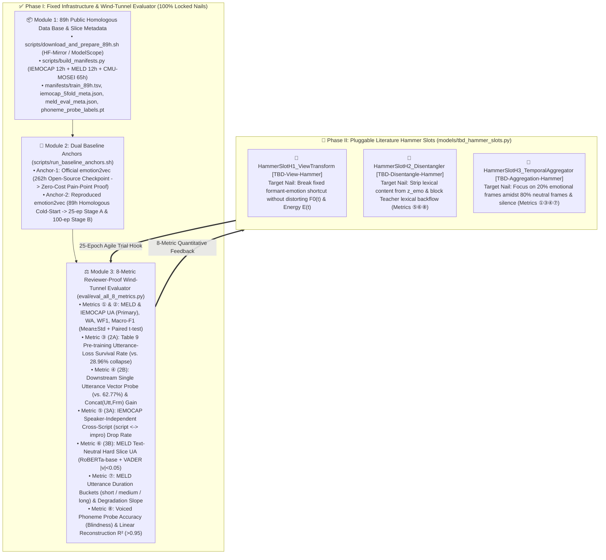

# DisEmo2vec: Fixed Wind-Tunnel Evaluation Suite & Pluggable Literature Hammer Architecture

> **Engineering Repository**: `D:\Code\VibeCode\Antigravity\Project\DisEmo2vec_Project\`  
> **Architecture Blueprint**: `EXP_BLUEPRINT_V2_1_FIXED_NAILS_TBD_HAMMERS.md` (RFC-005 V7.4)  
> **Target Venues**: IEEE/ACM TASLP / ACL Main

---

## 1. Architectural Philosophy: Fixed Nails (Phase I) vs. Pluggable Literature Hammers (Phase II)

`DisEmo2vec_Project` strictly decouples **100% locked problem definitions, fair 89h data manifests, and an 8-metric reviewer-proof wind-tunnel evaluation suite (Phase I: Nails)** from **pluggable, iterative algorithm slots derived from top-journal literature cards (Phase II: `[TBD-Hammer-Slots: H1 / H2 / H3]`)**.



---

## 2. Repository Directory Structure

```text
DisEmo2vec_Project/
├── README.md                          # Architecture overview & AutoDL dual-container guide
├── .gitignore                         # Ignores large checkpoints, audio files, and cache
├── configs/
│   └── default_wind_tunnel.yaml       # Unified configuration for Phase I evaluation & Phase II TBD slots
├── scripts/
│   ├── download_and_prepare_89h.sh    # AutoDL turbo + HF-Mirror/ModelScope 89h audio & model downloader
│   ├── build_manifests.py             # 16kHz validator, train_89h.tsv, 5-fold/slice JSONs & KMeans(500) generator
│   └── run_baseline_anchors.sh        # Anchor-1 (262h official) & Anchor-2 (89h 25-ep / 100-ep) runner
├── eval/
│   └── eval_all_8_metrics.py          # Frozen-backbone 0.20M linear probe wind-tunnel for all 8 metrics
├── models/
│   └── tbd_hammer_slots.py            # Standardized [TBD-Hammer-Slots: H1 / H2 / H3] interfaces & red-line guards
├── manifests/                         # Generated TSV/JSON manifests and offline K-means probe targets
├── results/                           # Automated JSON & Markdown 8-metric evaluation reports
└── paper/                             # Figures, tables, and LaTeX/Markdown drafts (managed by 0-Arch-Paper)
```

---

## 3. AutoDL Dual-Container Workflow Guide

To maximize cost-efficiency and experimental velocity on AutoDL, we separate **Single-GPU Evaluation / Data Prep** from **Multi-GPU Pre-training**:

### Container A: Single-GPU Wind-Tunnel & Data Prep (`1x RTX 4090 / RTX 3090`)
Used for downloading the 89h public dataset, building slice metadata, running **Anchor-1 (Official 262h zero-cost pain-point proof)**, and evaluating checkpoints on all 8 metrics.

```bash
# Step 1: Enable AutoDL academic turbo & download 89h datasets + base checkpoints
bash scripts/download_and_prepare_89h.sh --data-root /root/autodl-tmp/datasets --ckpt-root /root/autodl-tmp/checkpoints

# Step 2: Build Fairseq pre-training manifest, speaker-independent 5-fold slices, MELD hard slices, and K=500 phoneme labels
python scripts/build_manifests.py \
    --data-root /root/autodl-tmp/datasets \
    --ckpt-root /root/autodl-tmp/checkpoints \
    --manifest-dir manifests

# Step 3: Run Anchor-1 (Official emotion2vec 262h) to generate zero-cost pain-point proof on all 8 metrics
bash scripts/run_baseline_anchors.sh --mode anchor1 --ckpt-root /root/autodl-tmp/checkpoints
```

### Container B: Multi-GPU Pre-training & 25-Epoch Hammer Trials (`2x or 4x RTX 4090`)
Used for **Anchor-2 (89h homologous cold-start baseline at 25-ep & 100-ep)** and subsequent **Phase II 25-Epoch Literature Hammer trials**.

```bash
# Run Anchor-2 (Reproduced emotion2vec on train_89h.tsv from data2vec-audio-base-960h cold start)
# Automatically saves reproduced_emotion2vec_89h_ep25.pt (Stage A ruler) & reproduced_emotion2vec_89h_ep100.pt (Stage B ruler)
bash scripts/run_baseline_anchors.sh --mode anchor2 --gpus 4 --data-root /root/autodl-tmp/datasets --ckpt-root /root/autodl-tmp/checkpoints
```

---

## 4. Quick Self-Test (Zero-Dependency Verification)

Verify the 8-metric wind-tunnel evaluator and Phase II `[TBD-Hammer-Slots: H1 / H2 / H3]` red-line assertions anytime via:

```bash
python eval/eval_all_8_metrics.py --self-test
```
