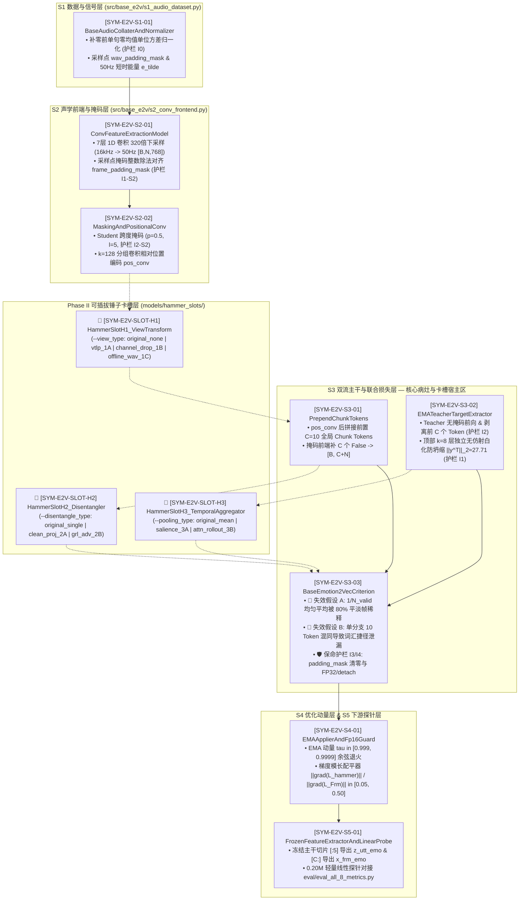

# 《emotion2vec / DisEmo2vec》基础代码双向静态共生解剖手册（Step 5 & Step 7 权威基线）

> **自动同步引擎**：`tools/base_code_symbiosis_sync.py`（基于 AST 语法树指纹 `ast_hash` 与 `@bce_contract` 双向锁死）
> **配套机读清单**：`docs/symbol_manifest.json`
> **验证状态**：运行 `python tools/base_code_symbiosis_sync.py --verify` 100% 通过静态双射校验

### 📌 三源认知标签体系（5% 反思防混淆增量补丁）
为防止在拆解底座代码与设计新锤子时混淆「原论文宣称的机制」、「Fairseq 源码实际干的事」与「本试验田新增的传感器」，本手册所有条目严格区分以下三源标签：
1. **`[论文原貌 Paper Claim]`**：ACL 2024 `emotion2vec` 原论文正文宣称的数学公式与设计意图（例如宣称 Utterance Loss 与 Frame Loss 协同学到全局与局部情感）；
2. **`[源码客观事实 Code Reality]`**：原版 `emotion2vec` Fairseq 源码中真实执行的张量运算与隐式假设（例如 `s2_conv_frontend.py` 首层 GroupNorm 抹平绝对声压级、`s3_dual_stream_backbone.py` 顶部 $k=8$ 层必须做无仿射参数 InstanceNorm 白化使 $\Vert y^T_i \Vert_2 \approx 27.71$、以及 Table 9 暴露的单抽 `Utt` 仅 `62.77%` 负资产退化）；
3. **`[外挂诊断传感器 Sensor Patch]`**：原版 `emotion2vec` 源码中**原本不存在**、由本试验田在不改动原版主干拓扑的前提下旁路提取的无监督物理传感器或离线探针（例如 `[SYM-E2V-S1-01]` 旁路提取的 50Hz 句内标准化短时能量 `frame_energy_std` $\tilde{e}_i$ 专为卡槽 `[SLOT-H3]` 提供有声门控，以及离线提取的 HuBERT $K=500$ 软分布 $P_{\text{hubert}}$ 专为卡槽 `[SLOT-H2]` 提供无监督海绵靶标）。

---

## 一、 S1 ~ S5 五层基础代码拓扑与 H1 ~ H3 卡槽精确咬合全景图

---

## 二、 基础代码五层静态符号契约台账（`[SYM-E2V-S1-01]` ~ `[SYM-E2V-S5-01]`）

<!-- [SYM-E2V-S1-01:START] file="src/base_e2v/s1_audio_dataset.py" lines="18-118" ast_hash="2b5e0e31" -->
### `[SYM-E2V-S1-01]` FileAudioDataset 单句波形层归一化与 Collater 动态补零掩码器 (`BaseAudioCollaterAndNormalizer`)

- **绑定源码坐标**：[s1_audio_dataset.py (L18-L118)](file:///D:/Code/VibeCode/Antigravity/Project/DisEmo2vec_Project/src/base_e2v/s1_audio_dataset.py#L18-L118) | **拓扑层**：`S1` | **AST 指纹**：`2b5e0e31`
- **输入张量契约 (`tensor_input`)**：`raw_wavs: List[FloatArray[T_b]] (16kHz mono PCM, variable length T_b)`
- **输出张量契约 (`tensor_output`)**：`source: FloatTensor[B, T_max], wav_padding_mask: BoolTensor[B, T_max] (True=Pad), frame_energy_std: FloatTensor[B, N_frm]`
- **绑定/预留卡槽 (`reserved_slot_id`)**：`Upstream provider for [SLOT-H1: HammerSlotH1_ViewTransform] & [SLOT-H3: frame_energy_std]`

#### 📐 数学与信号处理假设 (`signal_math_assumptions`)
- 【信号假设 S1-A1】每条语音在补零前独立执行整句零均值单位方差归一化: x_hat = (x - mu_x) / sqrt(sigma_x^2 + 1e-5)，消除录音设备增益差异，但保留句内相对能量包络起伏。
- 【信号假设 S1-A2】动态组批时按 Batch 内最长语音 T_max 在右侧补 0.0 (恰等于归一化后的静音均值)，同步生成采样点级布尔掩码 wav_padding_mask (True 代表补零点，False 代表真实采样点)。
- 【信号假设 S1-A3】同步以窗长 400 (25ms)、步长 320 (20ms, 对齐 S2 320倍下采样) 仅在有效帧上计算句内零均值单位方差短时能量 e_tilde_i = (e_i - mu_e) / (sigma_e + 1e-6)。

#### 🛡️ 绝对不可破坏的保命护栏 (`hard_invariants`)
- 【保命护栏 I0】单句 LayerNorm 必须在右侧补零 (Padding) 之前对真实采样点 [0 : T_b] 独立执行！严禁先补零再做整句归一化，否则大量补零会拉低方差、扭曲短句波形幅值！

#### 🎯 原版失效假设 / 钉子精确代码位点 (`broken_assumptions`)
- 【原版隐性缺陷 B0】Student 与 Teacher 共享完全相同的原始波形输入 source，未对 Student 施加任何破坏固定音素共振峰的视角微扰，导致模型可通过死记特定共振峰包络走情绪分类捷径。
<!-- [SYM-E2V-S1-01:END] -->

---

<!-- [SYM-E2V-S2-01:START] file="src/base_e2v/s2_conv_frontend.py" lines="32-115" ast_hash="37fbb514" -->
### `[SYM-E2V-S2-01]` 7层 1D 卷积 320倍下采样声学编码器与帧级掩码对齐器 (`ConvFeatureExtractionModel`)

- **绑定源码坐标**：[s2_conv_frontend.py (L32-L115)](file:///D:/Code/VibeCode/Antigravity/Project/DisEmo2vec_Project/src/base_e2v/s2_conv_frontend.py#L32-L115) | **拓扑层**：`S2` | **AST 指纹**：`37fbb514`
- **输入张量契约 (`tensor_input`)**：`source: FloatTensor[B, T_wav], wav_padding_mask: BoolTensor[B, T_wav]`
- **输出张量契约 (`tensor_output`)**：`features_768: FloatTensor[B, N_frm, 768], frame_padding_mask: BoolTensor[B, N_frm] (True=Pad)`
- **绑定/预留卡槽 (`reserved_slot_id`)**：`Acoustic feature & frame_padding_mask provider for [SLOT-H1] & [SLOT-H3]`

#### 📐 数学与信号处理假设 (`signal_math_assumptions`)
- 【信号假设 S2-A1】7 层 1D 卷积核与步长为 [(10,5), (3,2)*4, (2,2)*2]，总步长 prod(stride) = 320 (20ms/帧, 50Hz)，总感受野为 400 个采样点 (25ms)。
- 【信号假设 S2-A2】首层卷积后经过 GroupNorm/LayerNorm 与 GELU 激活，再经 Linear(512->768) + LayerNorm(768) 投射为 768 维局部声学帧特征，此时单帧幅值已被局部归一化重塑。
- 【数学假设 S2-A3】采样点级有效长度 L_wav 通过 7 次递推整数除法 L_{k} = floor((L_{k-1} - kernel_k) / stride_k + 1) 精确映射为有效帧数 N_valid，严格等价于 floor((L_wav - 400) / 320) + 1。

#### 🛡️ 绝对不可破坏的保命护栏 (`hard_invariants`)
- 【保命护栏 I1-S2】帧级 frame_padding_mask 的时间维长度必须与卷积输出帧数 N_frm 100% 精确相等，且每句话的非 Padding 帧数必须严格等于递推卷积公式算出的 N_valid！

#### 🎯 原版失效假设 / 钉子精确代码位点 (`broken_assumptions`)
- 【原版隐性缺陷 B2-01】首层卷积后的归一化抹平了绝对声压级，使得后续 Transformer 很难仅凭特征范数区分纯静音帧与低能量叹息帧，需在 [SLOT-H3] 中显式引入 S1 提取的短时能量软门控 sigma(e_tilde_i)。
<!-- [SYM-E2V-S2-01:END] -->

---

<!-- [SYM-E2V-S2-02:START] file="src/base_e2v/s2_conv_frontend.py" lines="118-200" ast_hash="cc236e12" -->
### `[SYM-E2V-S2-02]` Student 时间跨度掩码器与 pos_conv 相对位置卷积层 (`MaskingAndPositionalConv`)

- **绑定源码坐标**：[s2_conv_frontend.py (L118-L200)](file:///D:/Code/VibeCode/Antigravity/Project/DisEmo2vec_Project/src/base_e2v/s2_conv_frontend.py#L118-L200) | **拓扑层**：`S2` | **AST 指纹**：`cc236e12`
- **输入张量契约 (`tensor_input`)**：`features: FloatTensor[B, N_frm, 768], frame_padding_mask: BoolTensor[B, N_frm]`
- **输出张量契约 (`tensor_output`)**：`student_conv_pos: FloatTensor[B, N_frm, 768], mask_indices: BoolTensor[B, N_frm] (True=Masked)`
- **绑定/预留卡槽 (`reserved_slot_id`)**：`Host for [SLOT-H1: HammerSlotH1_ViewTransform] & mask_indices provider for [SYM-E2V-S3-03]`

#### 📐 数学与信号处理假设 (`signal_math_assumptions`)
- 【数学假设 S2-A4】时间掩码仅对 Student 分支开启 (mask_prob=0.5, mask_length=5, 约覆盖 100ms 连续音素段)，且严禁在 frame_padding_mask==True 的补零帧上采样掩码！
- 【工程顺序假设 S2-A5】先将 Student 被掩码帧替换为可学习 mask_emb，再将 frame_padding_mask==True 处清零，随后送入核宽 128、groups=16 的 pos_conv 叠加相对位置编码，最后才进入 S3 拼接前置 Chunk Tokens！

#### 🛡️ 绝对不可破坏的保命护栏 (`hard_invariants`)
- 【保命护栏 I2-S2】mask_indices 必须满足 (mask_indices & frame_padding_mask).any() == False，即补零帧绝对不能被标记为待预测的 Masked 目标帧！

#### 🎯 原版失效假设 / 钉子精确代码位点 (`broken_assumptions`)
- 【原版隐性缺陷 B2-02】固定 100ms (l=5) 时间掩码主要迫使模型做局部协同发音完形填空，若不配合 [SLOT-H1] 的频谱共振峰微扰，Student 仍可从未掩码相邻帧直接抄袭音素身份。
<!-- [SYM-E2V-S2-02:END] -->

---

<!-- [SYM-E2V-S3-01:START] file="src/base_e2v/s3_dual_stream_backbone.py" lines="19-64" ast_hash="6db989cd" -->
### `[SYM-E2V-S3-01]` 前置 C=10 可学习 Chunk Tokens 拼接与掩码扩展器 (`PrependChunkTokens`)

- **绑定源码坐标**：[s3_dual_stream_backbone.py (L19-L64)](file:///D:/Code/VibeCode/Antigravity/Project/DisEmo2vec_Project/src/base_e2v/s3_dual_stream_backbone.py#L19-L64) | **拓扑层**：`S3` | **AST 指纹**：`6db989cd`
- **输入张量契约 (`tensor_input`)**：`conv_pos_features: FloatTensor[B, N_frm, 768], frame_padding_mask: BoolTensor[B, N_frm]`
- **输出张量契约 (`tensor_output`)**：`extended_x: FloatTensor[B, C+N_frm, 768], extended_padding_mask: BoolTensor[B, C+N_frm]`
- **绑定/预留卡槽 (`reserved_slot_id`)**：`Direct structural host for [SLOT-H2: HammerSlotH2_Disentangler.split_and_pool_chunks]`

#### 📐 数学与信号处理假设 (`signal_math_assumptions`)
- 【工程顺序假设 S3-A1】C=10 个可学习 extra_tokens 必须在 pos_conv 相对位置卷积之后、进入 12 层 Transformer Self-Attention 之前拼接到序列最前端！
- 【掩码假设 S3-A2】由于前置 C=10 个全局 Token 对所有样本均有效，frame_padding_mask [B, N_frm] 前端必须拼接全 False 张量 [B, C]，扩展为 [B, C+N_frm]。

#### 🛡️ 绝对不可破坏的保命护栏 (`hard_invariants`)
- 【保命护栏 I0-S3】前置 C=10 个 Chunk Tokens 在预训练阶段必须保持 requires_grad=True，且对应的前 C 位 padding_mask 必须恒为 False，确保全局注意力双向畅通！

#### 🎯 原版失效假设 / 钉子精确代码位点 (`broken_assumptions`)
- 【原版隐性缺陷 B3-01】原版将全部 C=10 个前置 Token 无差别混同为单一情绪通道，未将其划分为独立的情感专属 Token (前5个) 与词汇海绵 Token (后5个)。
<!-- [SYM-E2V-S3-01:END] -->

---

<!-- [SYM-E2V-S3-02:START] file="src/base_e2v/s3_dual_stream_backbone.py" lines="67-157" ast_hash="afba65f7" -->
### `[SYM-E2V-S3-02]` EMA Teacher Top-K 白化帧目标生成器 (`EMATeacherTargetExtractor`)

- **绑定源码坐标**：[s3_dual_stream_backbone.py (L67-L157)](file:///D:/Code/VibeCode/Antigravity/Project/DisEmo2vec_Project/src/base_e2v/s3_dual_stream_backbone.py#L67-L157) | **拓扑层**：`S3` | **AST 指纹**：`afba65f7`
- **输入张量契约 (`tensor_input`)**：`clean_conv_features: FloatTensor[B, N_frm, 768], frame_padding_mask: BoolTensor[B, N_frm]`
- **输出张量契约 (`tensor_output`)**：`y_teacher: FloatTensor[B, N_frm, 768] (whitened per-frame target, ||y^T_i||_2 ~ 27.71)`
- **绑定/预留卡槽 (`reserved_slot_id`)**：`Upstream target provider for [SLOT-H2: HammerSlotH2_Disentangler] & [SLOT-H3: HammerSlotH3_TemporalAggregator]`

#### 📐 数学与信号处理假设 (`signal_math_assumptions`)
- 【信号假设 S3-A3】Teacher 全程输入未经掩码 (mask=False) 且未经视角微扰的干净声学特征，拥有完整双向上下文视野。
- 【数学假设 S3-A4】经每层无仿射参数 LayerNorm 白化并求 8 层平均后，每个有效帧向量 y^T_i in R^768 满足均值 mu=0、方差 sigma^2=1，其欧氏二范数恒定在 ||y^T_i||_2 = sqrt(768) ≈ 27.71！

#### 🛡️ 绝对不可破坏的保命护栏 (`hard_invariants`)
- 【保命护栏 I1】在提取顶部 k=8 层 Transformer 输出时，每一层输出必须先独立执行无仿射参数的 F.instance_norm / F.layer_norm (将每帧每层拉回零均值单位方差)，再对 8 层求算术平均并再次归一化，否则自监督蒸馏会在 100 步内坍缩为常数向量！
- 【保命护栏 I2】必须执行 y = y[:, self.num_extra_tokens:, :] 剥离前 C=10 个 Chunk Tokens，且将 frame_padding_mask==True 的补零帧严格置零，确保帧目标仅对应真实声学时间步 N_frm！

#### 🎯 原版失效假设 / 钉子精确代码位点 (`broken_assumptions`)
- 【原版隐性缺陷 B1】Teacher 的 8 层平均表征 y_teacher 中同时高度纠缠了副语言情绪韵律与词汇音素身份（中高层仍具极高音素可分性），直接作为全局回归目标会导致 Student 死记词汇捷径。
<!-- [SYM-E2V-S3-02:END] -->

---

<!-- [SYM-E2V-S3-03:START] file="src/base_e2v/s3_criterion_loss.py" lines="20-129" ast_hash="7f059594" -->
### `[SYM-E2V-S3-03]` 原版无差别均值池化句级损失与掩码帧损失计算器 (`BaseEmotion2VecCriterion`)

- **绑定源码坐标**：[s3_criterion_loss.py (L20-L129)](file:///D:/Code/VibeCode/Antigravity/Project/DisEmo2vec_Project/src/base_e2v/s3_criterion_loss.py#L20-L129) | **拓扑层**：`S3` | **AST 指纹**：`7f059594`
- **输入张量契约 (`tensor_input`)**：`student_out: FloatTensor[B, C+N_frm, 768], y_teacher: FloatTensor[B, N_frm, 768], mask_indices: BoolTensor[B, N_frm], frame_padding_mask: BoolTensor[B, N_frm]`
- **输出张量契约 (`tensor_output`)**：`loss_dict: Dict[loss_total, loss_frm, loss_utt, utt_target]`
- **绑定/预留卡槽 (`reserved_slot_id`)**：`Direct host for [SLOT-H2: HammerSlotH2_Disentangler] & [SLOT-H3: HammerSlotH3_TemporalAggregator]`

#### 📐 数学与信号处理假设 (`signal_math_assumptions`)
- 【数学假设 S3-A5】帧级损失 L_Frm 仅在被时间掩码覆盖且非补零的有效帧集合 M = (mask_indices & ~frame_padding_mask) 上计算 MSE / Smooth-L1 距离。
- 【量级假设 S3-A6】由于 y_teacher 每维方差为 1.0，未缩放的单帧各维平方误差均值为 O(1.0)，总损失 L_total = L_Frm + alpha * L_Utt (默认 alpha = 1.0)。

#### 🛡️ 绝对不可破坏的保命护栏 (`hard_invariants`)
- 【保命护栏 I3】计算任何跨时间步聚合 (均值或 Softmax 池化) 时，必须将 frame_padding_mask==True 的补零帧权重严格置零，分母必须取真实有效帧数 N_valid = (~frame_padding_mask).sum(dim=1)！
- 【保命护栏 I4】损失累加必须在 FP32 精度 (.float() / float32) 下执行，且 y_teacher 在进入损失前必须执行 .detach() 阻断向 Teacher 的梯度回传！

#### 🎯 原版失效假设 / 钉子精确代码位点 (`broken_assumptions`)
- 【失效假设 A (对应钉子 1 / Table 9 双重退化 & 指标 ⑦ 长句稀释)】utt_target = (y_teacher * valid_mask).sum(1) / N_valid 强行假设整句话所有有声帧的情绪贡献度恒为均匀 1/N_valid。在自然对话 (MELD) 中 80% 为平淡过场帧，导致均值向量被平淡背景严重主宰与稀释！
- 【失效假设 B (对应钉子 2 / 指标 ⑤ 跨剧本掉点 & 指标 ⑧ 音素泄漏)】z_student = student_out[:, :C, :].mean(dim=1) 将全部 C=10 个前置 Chunk Tokens 混为单一向量直接逼近含词汇音素的 utt_target，未给词汇内容留出分流排泄通道！
<!-- [SYM-E2V-S3-03:END] -->

---

<!-- [SYM-E2V-S4-01:START] file="src/base_e2v/s4_ema_and_fp16.py" lines="19-85" ast_hash="06b8e80c" -->
### `[SYM-E2V-S4-01]` EMA Teacher 动量退火更新器与 FP16/FP32 数值安全守卫 (`EMAApplierAndFp16Guard`)

- **绑定源码坐标**：[s4_ema_and_fp16.py (L19-L85)](file:///D:/Code/VibeCode/Antigravity/Project/DisEmo2vec_Project/src/base_e2v/s4_ema_and_fp16.py#L19-L85) | **拓扑层**：`S4` | **AST 指纹**：`06b8e80c`
- **输入张量契约 (`tensor_input`)**：`student_params: Dict[str, Tensor], teacher_params: Dict[str, Tensor], step: int`
- **输出张量契约 (`tensor_output`)**：`tau_step: float, updated_teacher_params: Dict[str, Tensor], grad_norm_ratio: float`
- **绑定/预留卡槽 (`reserved_slot_id`)**：`Optimization & Grad-Norm Auto-Balancer guard for [SLOT-H1/H2/H3]`

#### 📐 数学与信号处理假设 (`signal_math_assumptions`)
- 【数学假设 S4-A1】Teacher 参数 theta_T 不参与任何反向传播，仅在每步 optimizer.step() 后按 theta_T <- tau * theta_T + (1 - tau) * theta_S 滑动更新。
- 【退火假设 S4-A2】EMA 动量系数 tau 从初始值 tau_0 = 0.999 在 warmup_steps (如 30,000 步) 内按余弦或线性轨迹退火至终值 tau_end = 0.9999。
- 【梯度均衡假设 S4-A3】新插入卡槽的辅助锤子损失梯度范数 ||grad(L_hammer)||_2 与主损失梯度范数 ||grad(L_Frm)||_2 的比值应维持在 [0.05, 0.50] 黄金区间内，防止冲垮 Student 主干。

#### 🛡️ 绝对不可破坏的保命护栏 (`hard_invariants`)
- 【保命护栏 I5】前置 Chunk Tokens 与新插入卡槽的专属分类头 (如海绵线性头 W_c) 不拷入 Teacher EMA 字典，仅对共享的卷积与 Transformer 主干层执行 EMA 更新！
- 【保命护栏 I6】在 FP16 混合精度训练下，KL 散度、余弦相似度分母范数与 Softmax 温度缩放前必须先转 FP32 并加 clamp_min(1e-6)，严防 exp() 上溢 > 65504 触发 NaN！

#### 🎯 原版失效假设 / 钉子精确代码位点 (`broken_assumptions`)
- 【原版隐性缺陷 B4-01】当预训练关闭帧级损失 L_Frm 仅保留原版 L_Utt 时 (Table 9 指标 2A)，由于缺乏局部锚定且均值池化抹平了帧间差异，EMA Teacher 与 Student 迅速陷入表征坍缩 (WA 暴跌至 28.96%)。
<!-- [SYM-E2V-S4-01:END] -->

---

<!-- [SYM-E2V-S5-01:START] file="src/base_e2v/s5_downstream_probe.py" lines="19-107" ast_hash="4dabf495" -->
### `[SYM-E2V-S5-01]` 下游冻结主干 Utt/Frm 切片导出与 0.20M 线性分类探针 (`FrozenFeatureExtractorAndLinearProbe`)

- **绑定源码坐标**：[s5_downstream_probe.py (L19-L107)](file:///D:/Code/VibeCode/Antigravity/Project/DisEmo2vec_Project/src/base_e2v/s5_downstream_probe.py#L19-L107) | **拓扑层**：`S5` | **AST 指纹**：`4dabf495`
- **输入张量契约 (`tensor_input`)**：`encoder_out: FloatTensor[B, C+N_frm, 768], frame_padding_mask: BoolTensor[B, N_frm]`
- **输出张量契约 (`tensor_output`)**：`z_utt_emo: FloatTensor[B, 768], x_frm_emo: FloatTensor[B, N_frm, 768]`
- **绑定/预留卡槽 (`reserved_slot_id`)**：`Downstream evaluation bridge to `eval/eval_all_8_metrics.py``

#### 📐 数学与信号处理假设 (`signal_math_assumptions`)
- 【切片边界假设 S5-A1】Student 顶层输出序列长度为 C+N_frm：前 C 个位置 [:C] 为全局 Chunk Tokens，第 C 个位置之后 [C:] 为 50Hz 声学帧特征序列 X^S_emo。
- 【探针预算假设 S5-A2】下游评测时主干网络 100% 冻结 (requires_grad=False)，仅训练 768 -> 256 -> num_classes 的两层轻量线性探针 (参数量 197,892 <= 0.20M)。

#### 🛡️ 绝对不可破坏的保命护栏 (`hard_invariants`)
- 【保命护栏 I7】下游情感分类评测时，若启用 [SLOT-H2] 双分支切分 (前5个为情感 Token，后5个为内容海绵 Token)，必须严格只抽取前 5 个情感 Token 求平均作为 z_utt_emo，直接丢弃后 5 个内容海绵 Token 与分类头 W_c，确保下游推理零额外参数开销！

#### 🎯 原版失效假设 / 钉子精确代码位点 (`broken_assumptions`)
- 【原版隐性缺陷 B5-01 (对应 Table 9 指标 2B)】原版在下游单抽全局向量 z_utt 时准确率仅 62.77%（比单抽帧特征 Frm 的 71.79% 暴跌 9.02%），甚至把 z_utt 与 Frm 拼接后 (71.60%) 比不拼还低，证明原版全局 Token 已沦为负资产。
<!-- [SYM-E2V-S5-01:END] -->

---

## 三、 第 6 步可插拔锤子卡槽双向静态契约（`[SYM-E2V-SLOT-H1]` ~ `[SYM-E2V-SLOT-H3]`）

<!-- [SYM-E2V-SLOT-H1:START] file="models/hammer_slots/slot_h1_view.py" lines="183-275" ast_hash="fcfb6971" -->
### `[SYM-E2V-SLOT-H1]` 卡槽 H1 输入/特征视角微扰锤 (支持 --view_type 开关热插拔) (`HammerSlotH1_ViewTransform`)

- **绑定源码坐标**：[slot_h1_view.py (L183-L275)](file:///D:/Code/VibeCode/Antigravity/Project/DisEmo2vec_Project/models/hammer_slots/slot_h1_view.py#L183-L275) | **拓扑层**：`SLOT-H1` | **AST 指纹**：`fcfb6971`
- **输入张量契约 (`tensor_input`)**：`student_input: FloatTensor[B, N_frm, 768], frame_energy_std: FloatTensor[B, N_frm], offline_pert_x: Optional[FloatTensor[B, N_frm, 768]]`
- **输出张量契约 (`tensor_output`)**：`perturbed_student_x: FloatTensor[B, N_frm, 768], h1_meta: Dict`
- **绑定/预留卡槽 (`reserved_slot_id`)**：`[SLOT-H1: original_none | vtlp_1A | channel_drop_1B | offline_wav_1C | dw_gated_conv_1B | ms_ft_se_1C]`

#### 📐 数学与信号处理假设 (`signal_math_assumptions`)
- 仅对送入 Student 分支的特征或波形施加共振峰/通道微扰，Teacher 始终接收未经扰动的原始干净输入。
- 【叮嘱 2】当使用 offline_wav_1C 时，采用 (B, 1, 1) 布尔掩码执行 torch.where 逐样本独立掷硬币采样。

#### 🛡️ 绝对不可破坏的保命护栏 (`hard_invariants`)
- 【H1 防挑刺红线】变换前后短时能量包络余弦相关性必须 >= 0.98，严禁破坏决定情绪的基频轨迹 F0(t) 与能量起伏 E(t)！

#### 🎯 原版失效假设 / 钉子精确代码位点 (`broken_assumptions`)
- 精确修复 [SYM-E2V-S1-01 / S2-02] 的原版缺陷 B0/B2-02：切断 Student 对固定音素共振峰包络的死记硬背捷径。
<!-- [SYM-E2V-SLOT-H1:END] -->

---

<!-- [SYM-E2V-SLOT-H2:START] file="models/hammer_slots/slot_h2_disentangle.py" lines="576-719" ast_hash="069a1ba2" -->
### `[SYM-E2V-SLOT-H2]` 卡槽 H2 词汇-情感正交净水解耦锤 (支持 --disentangle_type 开关热插拔) (`HammerSlotH2_Disentangler`)

- **绑定源码坐标**：[slot_h2_disentangle.py (L576-L719)](file:///D:/Code/VibeCode/Antigravity/Project/DisEmo2vec_Project/models/hammer_slots/slot_h2_disentangle.py#L576-L719) | **拓扑层**：`SLOT-H2` | **AST 指纹**：`069a1ba2`
- **输入张量契约 (`tensor_input`)**：`z_emo: FloatTensor[B, 768], z_cont: FloatTensor[B, 768], y_teacher_sal: FloatTensor[B, 768], p_hubert_target: FloatTensor[B, 500]`
- **输出张量契约 (`tensor_output`)**：`h2_meta: Dict[loss_utt, loss_sponge, loss_dis, loss_total_h2, y_teacher_clean]`
- **绑定/预留卡槽 (`reserved_slot_id`)**：`[SLOT-H2: original_single | clean_proj_2A | grl_adv_2B | vicreg_cov_2C | gr_ssd_soft_2D | vclub_mi_2E]`

#### 📐 数学与信号处理假设 (`signal_math_assumptions`)
- 将前置 C=10 个 Chunk Tokens 对半切分为前 5 个情感 Token (z_emo) 与后 5 个内容海绵 Token (z_cont)。
- 【细节 1】在预训练阶段保持完整 PyTorch 计算图，使 loss_total_h2 梯度反传更新 Student 主干与 Chunk Tokens。

#### 🛡️ 绝对不可破坏的保命护栏 (`hard_invariants`)
- 【H2 防挑刺红线】100% 零外部人工标签；通过 Teacher 目标净水投影 + 共享分类头 sg(W_c) 均匀分布最大熵双保险阻断词汇回流；下游推理零额外参数开销！

#### 🎯 原版失效假设 / 钉子精确代码位点 (`broken_assumptions`)
- 精确修复 [SYM-E2V-S3-02 / S3-03] 的失效假设 B 与隐性缺陷 B1：将词汇音素正交分流至内容海绵分支，净化情感全局表征。
<!-- [SYM-E2V-SLOT-H2:END] -->

---

<!-- [SYM-E2V-SLOT-H3:START] file="models/hammer_slots/slot_h3_pooling.py" lines="477-645" ast_hash="56aa99ac" -->
### `[SYM-E2V-SLOT-H3]` 卡槽 H3 抗稀释时序显著性池化与加权帧损失锤 (支持 --pooling_type 开关热插拔) (`HammerSlotH3_TemporalAggregator`)

- **绑定源码坐标**：[slot_h3_pooling.py (L477-L645)](file:///D:/Code/VibeCode/Antigravity/Project/DisEmo2vec_Project/models/hammer_slots/slot_h3_pooling.py#L477-L645) | **拓扑层**：`SLOT-H3` | **AST 指纹**：`56aa99ac`
- **输入张量契约 (`tensor_input`)**：`y_teacher_frames: FloatTensor[B, N_frm, 768], frame_energy_std: FloatTensor[B, N_frm], padding_mask: BoolTensor[B, N_frm]`
- **输出张量契约 (`tensor_output`)**：`target_utt: FloatTensor[B, 768] (detached), weights_w: FloatTensor[B, N_frm] (detached), h3_meta: Dict`
- **绑定/预留卡槽 (`reserved_slot_id`)**：`[SLOT-H3: original_mean | salience_3A | attn_rollout_3B | autopool_3C | mh_eqp_3D | autostats_3E]`

#### 📐 数学与信号处理假设 (`signal_math_assumptions`)
- 【细节 2】输出的 target_utt 与 weights_w 均强制 .detach()，并将 weights_w 一鱼两吃传给掩码帧级损失 (1 + N_valid * sg(w_i)) * MSE。
- 【叮嘱 1】在 Softmax 前将 padding_mask==True 的补零帧打分设为 -1e9 (使 Padding 处 w_i = 0)，且句内均值与帧损失倍数均使用真实有效帧数 N_valid。

#### 🛡️ 绝对不可破坏的保命护栏 (`hard_invariants`)
- 【H3 防挑刺红线】严禁将纯静音帧 (e_tilde_i << 0) 误判为高权重帧（防 |e_tilde_i| 静音反噬漏洞）；兼顾高唤醒爆发与低唤醒叹息情绪！

#### 🎯 原版失效假设 / 钉子精确代码位点 (`broken_assumptions`)
- 精确修复 [SYM-E2V-S3-03] 的失效假设 A：打破 1/N_valid 无差别平均造成的 80% 平淡帧稀释瓶颈。
<!-- [SYM-E2V-SLOT-H3:END] -->

---

## 四、 第 7 步顺畅搜锤与试锤四大闭环保障机制（内嵌规范）

### 1. 跨领域搜锤地图（按钉子数学本质借锤）
- **针对 `[SYM-E2V-SLOT-H3]`（80% 平淡帧稀释 20% 情绪爆发帧 —— 弱监督稀疏事件汇聚）**：
  - **矿区 A（DCASE / TASLP 弱监督音频事件检测）**：`AutoPool`（自适应指数软池化）、`Gated Attention MIL`、`Power-Mean Pooling`；
  - **矿区 B（CVPR / ICLR 视觉动态 Token 显著性汇聚）**：`Attention Rollout Salience`、`Token Merging (ToMe)`。
- **针对 `[SYM-E2V-SLOT-H2]`（零人工标签剥离词汇与情绪 —— 无监督子空间去相关与信息擦除）**：
  - **矿区 A（ICML / NeurIPS / TASLP 零样本语音解耦）**：`ContentVec`、`SpeechSplit`、`Prosody2Vec`；
  - **矿区 B（ICLR / ICML 自监督非对比去相关）**：`Barlow Twins`（跨分支互相关矩阵非对角归零）、`VICReg`、`vCLUB` 互信息上界最小化。
- **针对 `[SYM-E2V-SLOT-H1]`（切断固定音素共振峰死记硬背 —— 保韵律声学信息瓶颈摄动）**：
  - **矿区**：`ContentVec / NANSY` 保基频频谱包络扭曲（VTLP）、保能量频带通道掩码（`channel_drop_1B`）。

### 2. 文献锤子本土化「三步阻抗匹配转译协议」
1. **Step A（无监督信号替换）**：严禁引入外部 ASR 文本/音素人工标签，统一替换为 `[SYM-E2V-S3-02]` 的白化 Teacher 特征 $Y^T$、`[SYM-E2V-S1-01]` 的短时能量 $\tilde{e}_i$（`[外挂诊断传感器 Sensor Patch]`）或离线 K=500 无监督音素簇分布 $P_{\text{hubert}}$（`[外挂诊断传感器 Sensor Patch]`）；
2. **Step B（量纲与范数阻抗匹配）**：注意 `[SYM-E2V-S3-02]` 输出的白化目标帧二范数恒为 $\Vert y^T_i \Vert_2 \approx \sqrt{768} = 27.71$（`[源码客观事实 Code Reality]`，而非单位球面 $\Vert z \Vert_2 = 1$），若文献公式基于余弦/球面假设，需在卡槽内先做局部 `F.normalize` 或温度缩放；
3. **Step C（`padding_mask` 掩码安全改写）**：一切求和 $\sum_{i=1}^N$ 或 `Softmax` 必须严格接入 `padding_mask`（打分置 `-1e9`、有效帧长取 $N_{\text{valid}}$），并通过 `scripts/smoke_test_hammer.py` 的 Padding 零泄漏断言（误差 $< 10^{-6}$）。

---

## 五、 `S1 ~ S5` 开放母板全链路 6 大候选切口表（3 个已激活卡槽 + 3 个储备扩展切口）

> **母板开放性原则**：`S1 ~ S5` 的 8 个基础符号均作为开放式实验母板。除当前在 `models/hammer_modules.py` 中已通过命令行开关激活的 **3 大主力卡槽（`SLOT-H1 / H2 / H3`）** 外，若后续文献阅读发现针对 Teacher 层间权重或掩码策略的强力新锤子，可直接沿以下预留坐标切入：

| 切口编号与状态 | 宿主符号与源码坐标 | 针对的原版失效假设 (`[Code Reality]`) | 可插拔算法机制与信号来源 |
| :--- | :--- | :--- | :--- |
| **`SLOT-H1`** `[ACTIVE 已激活]` | `[SYM-E2V-S2-02]` $\to$ `[SYM-E2V-SLOT-H1]` (`models/hammer_slots/slot_h1_view.py`) | Student 与 Teacher 共享完全相同的共振峰包络，模型通过死记特定说话人/音素共振峰走捷径 | `--view_type`: `vtlp_1A` (在线线性频谱扭曲) / `channel_drop_1B` (能量自适应通道掩码) / `offline_wav_1C` (离线变声副本 `(B,1,1)` 独立采样) |
| **`SLOT-H2`** `[ACTIVE 已激活]` | `[SYM-E2V-S3-01]` & `[SYM-E2V-S3-03]` $\to$ `[SYM-E2V-SLOT-H2]` (`models/hammer_slots/slot_h2_disentangle.py`) | 全部 $C=10$ 个前置 Chunk Tokens 混为单分支回归含音素的 Teacher 目标，导致严重音素泄漏与跨剧本掉点 | `--disentangle_type`: `clean_proj_2A` (前5情绪+后5海绵双分支正交投影 + `[Sensor Patch]` $P_{\text{hubert}}$ KL 吸附) / `grl_adv_2B` (梯度反转层) |
| **`SLOT-H3`** `[ACTIVE 已激活]` | `[SYM-E2V-S3-02]` & `[SYM-E2V-S3-03]` $\to$ `[SYM-E2V-SLOT-H3]` (`models/hammer_slots/slot_h3_pooling.py`) | `1/N_valid` 无差别时间平均被自然对话中 80% 的平淡/静音帧淹没，导致 Table 9 全局表征坍缩 (`28.96%`) 与长句严重稀释 | `--pooling_type`: `salience_3A` (`[Sensor Patch]` 短时能量软门控 $\sigma(\tilde{e}_i)$ $\times$ 局部背景偏离度 + $(1+N_{\text{valid}} w_i)$ 帧重加权) / `attn_rollout_3B` |
| **`Candidate-H4`** `[RESERVE 储备切口]` | `[SYM-E2V-S3-02]` `EMATeacherTargetExtractor` (`src/base_e2v/s3_dual_stream_backbone.py#L130-L142`) | 原版对 Teacher 顶部 $k=8$ 层 (`Layer 5..12`) 赋予完全相等的 `1/8` 算术平均权重，未区分中层副语言韵律层与高层语义/音素层 | **Teacher 顶部 8 层跨层非均匀加权 / 音素主导层降权切口**：将 `np.mean(top_k_whitened, axis=0)` 替换为可学习或基于层间音素探针盲度加权的 $\sum_{l=5}^{12} \beta_l \tilde{h}^{(l)}$ |
| **`Candidate-H5`** `[RESERVE 储备切口]` | `[SYM-E2V-S2-02]` `MaskingAndPositionalConv` (`src/base_e2v/s2_conv_frontend.py#L148-L165`) | 原版时间掩码 `compute_mask_indices` 在有效帧上均匀随机采样 (`p=0.5, l=5`)，大量掩码落在无信息的平淡静音段，情绪爆发段掩码不足 | **显著性引导时间掩码切口 (Salience-Guided Span Masking)**：利用 `[SYM-E2V-S1-01]` 的 `[Sensor Patch]` `frame_energy_std` 或基频变化率提高情绪爆发帧的掩码采样概率 |
| **`Candidate-H6`** `[RESERVE 储备切口]` | `[SYM-E2V-S4-01]` `EMAApplierAndFp16Guard` (`src/base_e2v/s4_ema_and_fp16.py#L52-L85`) | 原版对所有共享层使用单一固定轨迹的 EMA 动量 $\tau(t)$ 与固定辅助损失权重，未随解耦程度动态调节 | **动态梯度模长自平衡与分层 EMA 退火切口**：在预训练过程中每 $K$ 步根据 $\Vert \nabla \mathcal{L}_{\text{dis}} \Vert / \Vert \nabla \mathcal{L}_{\text{Frm}} \Vert$ 在线自适应微调 $\lambda_{\text{dis}}(t)$ |
